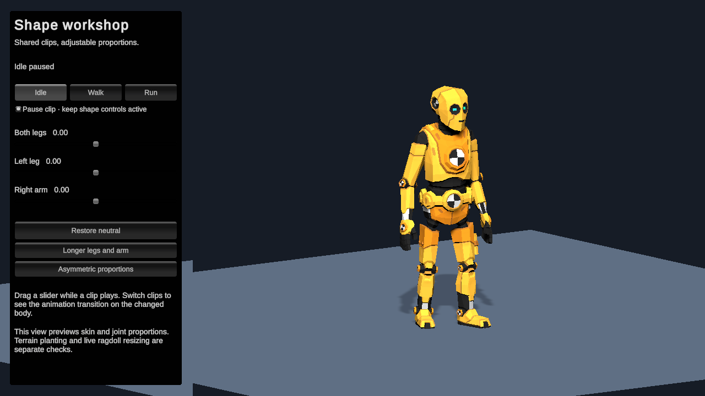
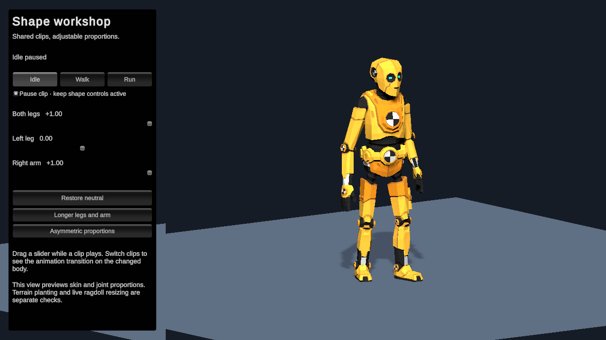

# SA Shape workshop

A real Synty character using shared SA animation clips with adjustable runtime proportions. Unity **7000.0.0a12**, URP and Entities Graphics. The two SA dependencies are pinned Git packages in `Packages/manifest.json`; there are no links to a particular user's home directory.

## Open and play

1. Open this project in Unity 7000.0.0a12. Allow the first package resolution/import to finish.
2. Choose **Tools → SA → Shape Workshop → Open Scene**, or open `Assets/Scenes/ShapeWalk.unity`.
3. Press **Play**. If the Game tab is small, choose **Tools → SA → Shape Workshop → Frame Game View**. It selects the 1280 × 720 workshop resolution and maximizes the Game view.
4. Drag **Both legs**, **Left leg** or **Right arm**. Switch **Idle / Walk / Run** while the body changes. **Pause clip** freezes the animation while keeping shape controls active.
5. Use **Restore neutral** to return all proportions to the original body.

Default Play starts the neutral character at the origin in Idle. Walk and Run are explicitly previews in place. The character scene, original atlas material, rig-specific stretch bases, definition and camera/lighting are saved in the project. The control panel is the intended demo UI; no probe or hidden test switch runs in the scene.

## Measured checks

Unity's Editor tests passed **95/95 SA tests** and **3/3 bridge tests** on the final Vulkan check. The GPU tests also passed on OpenGL during the repair, on Intel RPL-S graphics under Linux. These are Editor results, not player/platform performance claims.

The actual rendered Vulkan comparison uses the same Idle sample at time zero. Shape changes affect **50,345 character-view pixels** above 3/255. Restoring neutral reproduces all **50 palette matrices and 52 local joint poses exactly**, with **zero changed character-view pixels** above that threshold. The controls panel is excluded from pixel comparisons. See [the JSON receipt](docs/evidence/render-check.json), snapshots and captured PNGs in `docs/evidence`.

The scene was saved, reopened and played; the runtime Console was checked for errors and warnings. Original inverse binds remain in use. The shader computes normals from the inverse transpose of the blended position matrix and transforms tangents separately.

## Handoff

- [Implementation and verification details](https://github.com/IAFahim/sa-motion/blob/packet/SH5-shape-render-fix/docs/handoff/SH5.md)
- [Shader/test fix branch](https://github.com/IAFahim/com.sa.unity/tree/packet/SH5-shape-render-fix)
- [Original recovery issue](https://github.com/IAFahim/com.sa.unity/issues/2)
- [Full integration issue](https://github.com/IAFahim/sa-motion/issues/3)

The full 50-character/500-animation pilot, terrain planting, wardrobe/morph validation and live physical resizing remain separate gates. This scene verifies visible joint/skin proportion changes, shared animation and the renderer. It does not automatically resize a live ragdoll or infer garment fitting.
